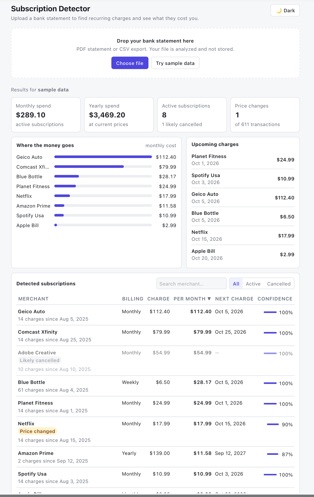

# Subscription Detector

Upload a bank statement CSV and find every recurring charge in it: streaming services, gym memberships, insurance and yearly renewals. The app shows what they cost per month and per year, when the next charge is due, which prices went up, and which subscriptions look cancelled.

**Stack:** Python 3.13 · FastAPI · Pydantic · pytest │ React 19 · TypeScript · Vite



## Features

- **Flexible CSV parsing:** handles different column names (`Date`/`Posted Date`, `Description`/`Payee`, `Amount`/`Debit`), six date formats, `$`/`,`/accounting-style `(12.00)` amounts, BOMs, and both bank sign conventions.
- **PDF statements:** extracts transactions from bank PDFs without per-bank templates. It skips account details, addresses, headers and footers; handles US and Indian layouts (dd/mm vs mm/dd detected automatically), Dr/Cr markers, separate withdrawal/deposit columns and missing years; infers debit vs credit from the running balance; and unlocks password-protected PDFs.
- **Merchant normalization:** `POS NETFLIX.COM 866-579 CA` and `NETFLIX.COM 8829` both become `netflix`.
- **Cadence detection:** weekly, biweekly, monthly, quarterly and yearly, with tolerance for weekends and month lengths.
- **Insights:** monthly and annual cost, next expected charge, price-change alerts, likely-cancelled detection, and a confidence score.
- **Dashboard:** summary cards, spend breakdown, upcoming charges, and a sortable, filterable, searchable table. Supports drag-and-drop upload and dark mode.

## How detection works

```
CSV ─► parse ─► keep debits ─► normalize merchant ─► group ─► per group:
        1. sort by date, drop same-day duplicates
        2. intervals between charges → median → match a cadence (±tolerance)
        3. ≥60% of intervals on schedule, ≥60% of amounts within 15% of median
        4. need ≥3 charges (≥2 for quarterly/yearly)
        5. confidence = 0.45·regularity + 0.35·amount stability + 0.20·history length
```

Using the **median** interval makes detection robust to one skipped or late payment. The amount tolerance allows for tax and FX swings and price increases while still rejecting variable spending like groceries.

## Accuracy

`scripts/evaluate.py` generates 300 labeled synthetic statements with date jitter, skipped payments, price increases, cancellations, noisy descriptions and lookalike distractors, then compares the detector against ground truth:

| Metric | Result |
|---|---|
| Precision | 99.7% |
| Recall | 99.8% |
| F1 | 99.8% |
| Cadence accuracy | 100% |
| Cancelled-flag accuracy | ~97% |

Remaining errors are fixed-price purchases at random times that happen to look periodic, and quarterly subscriptions with a skipped payment. Synthetic data is cleaner than real bank exports, so expect lower numbers on real statements; a hand-labeled real dataset is the next step.

```bash
cd backend && .venv/bin/python -m scripts.evaluate --statements 300 --seed 7
```

## Run it locally

**Quick start** (sets up dependencies on first run, starts both servers, Ctrl+C stops both):

```bash
./start.sh
```

Or run each part separately:

**Backend** (port 8001):

```bash
cd backend
python3 -m venv .venv && source .venv/bin/activate
pip install -r requirements.txt
uvicorn app.main:app --reload --port 8001
```

**Frontend** (port 5173, proxies `/api` to the backend):

```bash
cd frontend
npm install
npm run dev
```

Open http://localhost:5173 and click **Try sample data**, or upload your own CSV.

**Tests:**

```bash
cd backend && pytest        # 25 tests: parsing, normalization, cadence, API
cd frontend && npm run build && npm run lint
```

## API

| Method | Path | Description |
|---|---|---|
| `POST` | `/api/analyze` | Multipart upload (`file`). Returns summary and subscriptions. 422 on bad CSV, 413 if over 5 MB. |
| `GET` | `/api/sample` | Runs the analysis on the bundled sample statement. |
| `GET` | `/api/health` | Liveness check. |

Interactive docs are at http://localhost:8001/docs (auto-generated by FastAPI).

## Project structure

```
backend/
  app/detector.py      # pure detection logic (no framework, fully unit-tested)
  app/main.py          # FastAPI routes + Pydantic response models
  tests/               # pytest: detector unit tests + API tests
  scripts/generate_sample.py
  sample_data/sample_transactions.csv
frontend/src/
  types.ts             # TS interfaces mirroring the Pydantic models
  api.ts               # fetch wrappers with error handling
  App.tsx              # discriminated-union state: idle | loading | error | done
  components/          # FileUpload, SummaryCards, SpendBreakdown, UpcomingCharges, SubscriptionTable
```

## Possible next steps

- Fuzzy merchant matching (e.g. Levenshtein distance) for messier descriptions
- Persist uploads per user (PostgreSQL + auth)
- Plaid integration instead of CSV upload
- Docker Compose for one-command startup
